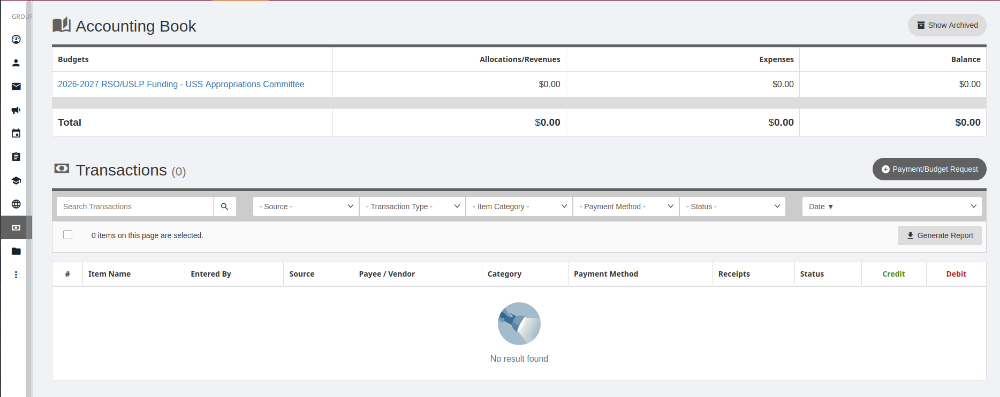
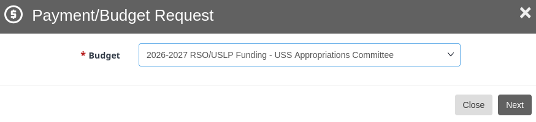

# USS Student Organization Funding

## Overview

This is a **reimbursement** based fund that you do not have to apply to or really do much to access. The main downside is that you have to order things very far ahead of time, so this should mainly be used for travel and items that you know you will need ahead of time, but the fund gives us a very good amount of money, so we should definitely use it!

## Accessing the Funds

To access these funds you need to visit the team's gobblerconnect page (make sure you are registered as an admin there). From there you can click on the Payment/ Budget Request button on the right as shown below.

Select the correct budget as shown below.

Then from there, there should be another button prompting you to create a budget request and fill out a form.

If you have any other questions, please consult another officer or read the USS funding manual as found below:

- <https://campuslife.vt.edu/content/campuslife_vt_edu/en/Student_Orgs/orgfunding/_jcr_content/content/vtcontainer_260361155/vtcontainer-content/vtmultitab_396657388/vt-items_0/download_copy_copy/file.res/2025-2026%20USS%20Appropriations%20Policy%20and%20Procedure.pdf>

## Funding Categories, Maximums, and General Rules

These are all subject to change. Please consult the most up to date version of the USS Student Organization Funding at TODO PUT THIS LINK TO THE USS FUNDING DOCUMENTATION HERE

### Funding Types and Maximums:

- Operational Funding (up to $6,000/year) for general events, supplies, equipment, insurance

- Guest speakers/performers under $5,000.

- Collaborations: $5,000 per org.

- Major Event Funding (up to $7,500/year). These are events in major venues (GLC, Squires, etc.) and having 1,000+ attendance, OR contracted guest over $5,000. Must apply 60 days in advance

- Conference/Competition/Service Trips (up to $3,000/year). Max 6 trips/year, 8 students funded per trip. Covers transportation, lodging, registration only (no meals). Must apply 30 days in advance

### Critical Deadlines

- Operational/Conference: 30 days before event

- Major Events: 60 days before event

- Reimbursements: 15 days after event (5 days after receiving invoice)

### What They WON'T Fund

- Food (except cultural tastings up to $1,500/year)

- Gift cards, prizes, promotional items

- Fundraising items, personal financial gain

- T-shirts/apparel for advertising

- Recruitment costs

- Individual membership dues

### Important Funding Caps

- Decorations: 20% of event budget or $300, whichever is lower

- Advertising: 20% of event budget max

- Photography/videography: $300/year (marketing only)

- Awards/trophies: $300/year

- Cultural food tastings: $1,500/year

You can learn more at the following links:

- <https://campuslife.vt.edu/content/campuslife_vt_edu/en/Student_Orgs/orgfunding/_jcr_content/content/vtcontainer_260361155/vtcontainer-content/vtmultitab_396657388/vt-items_0/download_copy_copy/file.res/2025-2026%20USS%20Appropriations%20Policy%20and%20Procedure.pdf>

- <https://campuslife.vt.edu/Student_Orgs/orgfunding.html>

If you have any questions, you can always email [appropriations@vt.edu](mailto:appropriations@vt.edu) or [orgfunding@vt.edu](mailto:orgfunding@vt.edu).
