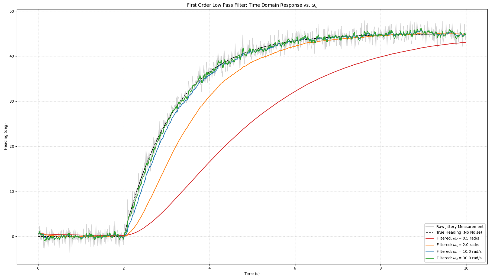
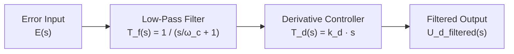
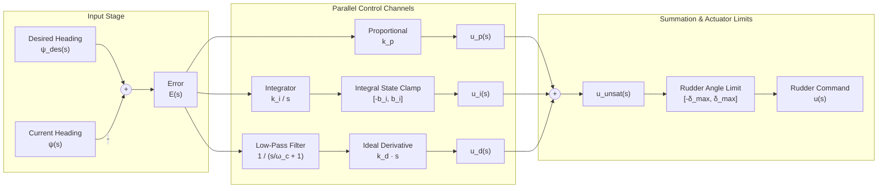

# 
 PIDn Controller Explanation 

In this document, we will go ahead and derive the PIDn controller that we use in the codebase and explain how it works. This document unfortunately will require that you have taken ECE 2714 "Signals and Systems" or an equivalent course. The math is just too involved to explain it all from scratch here unfortunately. If you would like to teach yourself the required information, I would recommend self studying concepts from single input, single output linear systems theory such as signals, systems, laplace transform, z transform, and block diagrams. For those who don't understand what a laplace or z transform are but do know about the fourier transform, in this case you can treat them as exactly the same except wherever you would normally write $j\omega$ or $e^{j\omega}$ you would instead write s and z respectively. This isn't true in general, but is good enough for these derivations.

# Proportional Integral Derivative Controller Definition

The definition of a proportional, integral, derivative controller is as follows:

$$u(t) = k_{p}e(t) + k_{i}\int_0^t e(\tau)d\tau + k_{d}\frac{de(t)}{dt}$$

Where e(t) is the error, generally defined as $e(t) = (setpoint(t) - position(t))$, u(t) is the output of the PID controller, and $k_p$, $k_i$, and $k_d$ are constants that the user sets and just mean how much weight should we give to each term in the controller.

let $u_{p}(t) = k_{p}e(t)$  
let $u_{i}(t) = k_{i}\int_{0}^{t}e(\tau)d\tau$  
let $u_{d}(t) = k_{d}\frac{de(t)}{dt}$  

then $u(t) = u_{p}(t) + u_{i}(t) + u_{d}(t)$

Now we can derive the implementation of each controller output individually and then add them all up at the end.

---

## 1. Proportional Term

$u_{p}(t) = k_{p}e(t)$ can be implemented exactly the same in discrete time

$$u_{p}[k] = k_{p}e[k]$$

proportional control output at timestep $k$ = $k_p \cdot \text{error at timestep } k$. Fairly simple I think.

---

## 2. Integral Term

$u_i(t)$: cannot be implemented easily. Lets derive the discrete time difference equation that describes the integral controller output

$$u_{i}(t) = k_{i}\int_0^t e(\tau)d\tau$$

taking the laplace transform on both sides removes the nasty continuous time integral. For a function in the laplace domain, there is a simple formula to find the equivalent in the $z$-domain, which can then be immediately transformed into a difference equation we can use in code. This ability to transform into the z domain and transform things in the z domain into an implementable form is the main reason that we are doing this laplace transform route.

$$\mathcal{L}\{u_{i}(t)\} = \mathcal{L}\left\{k_{i}\int_0^t e(\tau)d\tau\right\} \implies U_{i}(s) = k_{i}\frac{E(s)}{s} \implies \frac{U_{i}(s)}{E(s)} = T_{i}(s) = \frac{k_{i}}{s}$$

The $\frac{U_{i}(s)}{E(s)}$ represents the $\frac{\text{output}}{\text{input}}$ which is also known as the transfer function $T(s)$ of the integral controller. The meaning behind the transfer function is that if you have the input (in our case the error) as a function in the laplace domain, then you can simply multiply by the transfer function to get the output as a function in the laplace domain (this should be obvious by how we defined it).

We want the integral controller in terms of the transfer function since this is necessary to transform it to discrete time using something called the bilinear transform. There are many other methods that go by various names such as "backwards euler", "forwards euler", and "impulse invariant" methods. Each of these methods have different positives and negatives that we don't really need to care about right now. Just take my "proof by industry consensus" that for an integral controller, the bilinear transform is optimal. You can look this up online if you want.

The bilinear transform is defined as:

$$s = \frac{2}{T_{s}}\frac{z-1}{z+1}$$

where $T_s$ is the sampling period.

$$T_{i}(s) = \frac{k_{i}}{s} \implies T_{i}(z) = k_{i}\frac{T_{s}}{2}\frac{z+1}{z-1} = \frac{U_{i}(z)}{E(z)}$$

$$U_{i}(z) = \frac{k_{i}T_{s}}{2}\frac{z+1}{z-1}E(z)$$

$$(z - 1)U_{i}(z) = \frac{k_{i}T_{s}}{2}(zE(z) + E(z))$$

$$z U_{i}(z) - U_{i}(z) = \frac{k_{i}T_{s}}{2}(zE(z) + E(z))$$

Now, taking the inverse $z$ transform of both sides:

$$\mathcal{Z}^{-1}\{z U_{i}(z) - U_{i}(z)\} = \mathcal{Z}^{-1}\left\{\frac{k_{i}T_{s}}{2}(zE(z) + E(z))\right\}$$

$$u_{i}[k+1] - u_{i}[k] = \frac{k_{i}T_{s}}{2}(e[k+1] + e[k])$$

$$u_{i}[k+1] = u_{i}[k] + \frac{k_{i}T_{s}}{2}(e[k+1] + e[k])$$

we have now arrived at a difference equation that describes the control output of a discrete time PID controller. Remember, $k_i$ and $T_s$ are just constants the user sets.

Not all is pleasant in wonderland though! watch what happens when $e[k]=1$ for a long period of time.

let $u_{i}[0] = 0$ and $e[k] = 1$ for all $k$:

$$u_{i}[1] = u_{i}[0] + \frac{k_{i}T_{s}}{2}(e[1] + e[0]) = k_{i}T_{s}$$

$$u_{i}[2] = u_{i}[1] + \frac{k_{i}T_{s}}{2}(e[2] + e[1]) = k_{i}T_{s} + k_{i}T_{s} = 2k_{i}T_{s}$$

$$u_{i}[3] = u_{i}[2] + \frac{k_{i}T_{s}}{2}(e[3] + e[2]) = 2k_{i}T_{s} + k_{i}T_{s} = 3k_{i}T_{s}$$

so following this pattern $u_i$ at some arbitrary time $n \implies u_{i}[n] = n k_{i}T_{s} = \sum_{1}^{n} k_{i}T_{s}$

now, we may be able to rest assured that this did in fact "integrate" over our error in the discrete time context (aka a sum) but is that really what we want? I know its a bit silly to go through that whole derivation only to question the thing we wanted in the first place but think about it for a second. We just showed that there some fairly reasonable conditions where the control output becomes unbounded. There is a fairly easy fix though: we can enforce the fact that the integral controller output must be bounded by some constant $b_i$ such that $-b_{i} < u_{i}[k] < b_{i}$ using clamping:

$$u_{i\text{ clamped}}[k+1] = \text{clamp}\left(u_{i\text{ clamped}}[k] + \frac{k_{i}T_{s}}{2}(e[k+1] + e[k]), -b_{i}, b_{i}\right)$$

Now, our control output is forced to never become unbounded.

---

## 3. Derivative Term

$u_d(t)$: similarly to the integral controller cannot be implemented easily. Lets derive the discrete time difference equation that describes the derivative controller output. I will save much explanation since much of it is identical to the integral controller.

$$u_{d}(t) = k_{d}\frac{de(t)}{dt}$$

$$\mathcal{L}\{u_{d}(t)\} = \mathcal{L}\left\{k_{d}\frac{de(t)}{dt}\right\} \implies U_{d}(s) = k_{d}sE(s)$$

$$T_{d}(s) = k_{d}s$$

Now, here is where things differ a bit from the integral controller. Derivatives are very sensitive to high frequency sensor noise. Lets take a step back and see what the derivative error actually simplifies down to:

$$\frac{de(t)}{dt} = \frac{d}{dt}(e(t)) = \frac{d}{dt}(\text{set_point}(t) - \text{actual_position}(t))$$

If we are talking about a controller to turn the boat to a specific desired-heading value, the equation could also be written as the following:

$$\frac{de(t)}{dt} = \frac{d}{dt}(\text{desired_heading}(t) - \text{current_heading}(t)) = \frac{d}{dt}(\text{desired_heading}(t)) - \frac{d}{dt}(\text{current_heading}(t))$$

Now, take the following situation: we have a compass (heading sensor) that gives us 1000 samples per second but has a maximum error of 1 degree and the reading may jitter an entire degree between samples. If $\text{sample}_1 = 135.2^\circ$ and $\text{sample}_2 = 136.2^\circ$, the apparent derivative of the $\text{current_heading}(t)$ is:

$$\frac{d}{dt}(\text{current_heading}(t)) = \frac{\text{sample}_2 - \text{sample}_1}{\Delta t} = \frac{136.2^\circ - 135.2^\circ}{0.001\text{ s}} = 1000^\circ/\text{s}!$$

At that point, our derivative control output $\frac{de(t)}{dt}$ might also be nearly unbounded!

What we want now is some notion of a "smoothing" function so that given a very spiky function with large derivatives, we can lower "spikiness" while still keeping the general shape of the function. Thankfully, many people have worked on this problem and they have found certain systems called "filters" that do this job of smoothing a function.

This "low pass filter" system has the following transfer function in the laplace domain:

$$T_{f}(s) = \frac{1}{\frac{s}{\omega_{c}} + 1}$$

$\omega_c$ simply controls how aggressively we want to smooth the error. Below is a plot that shows the affect of various values of $\omega_c$ on a raw, noisy heading signal.

If we want to filter the error signal before passing it into our derivative controller, the block diagram would therefore look like this:

Remember that if we want to find the total transfer function of 2 blocks in series, we simply have to multiply their transfer functions:

$$T_{d\text{ filtered}}(s) = T_{d}(s)T_{f}(s) = \frac{k_{d}s}{\frac{s}{\omega_{c}} + 1} = \frac{k_{d}\omega_{c}s}{s + \omega_{c}}$$

We will now work off of this modified transfer derivative controller function since this controller is strictly more stable than an unfiltered derivative controller.

Alright now that that issue is solved, we can go on and transform this transfer function into the $z$-domain so we can put it into an implementable form. For the integral controller, we used the bilinear transform, but for the derivative controller the industry standard is to use the backwards euler transform (proof by everyone agrees this is the best way to implement this for the derivative controller).

The backwards euler transform is defined by the following:

$$s = \frac{z - 1}{T_{s}z}$$

where $T_s$ is the sampling period.

$$T_{d\text{ filtered}}(z) = \frac{k_{d}\omega_{c}\left(\frac{z-1}{T_{s}z}\right)}{\left(\frac{z-1}{T_{s}z}\right) + \omega_{c}} = \frac{k_{d}\omega_{c}(z-1)}{T_{s}z\left(\frac{z-1}{T_{s}z} + \omega_{c}\right)} = \frac{k_{d}\omega_{c}(z-1)}{z - 1 + T_{s}z\omega_{c}} = \frac{k_{d}\omega_{c}(z-1)}{(T_{s}\omega_{c} + 1)z - 1}$$

$$T_{d\text{ filtered}}(z) = \frac{U_{d\text{ filtered}}(z)}{E(z)} \implies \frac{k_{d}\omega_{c}z - k_{d}\omega_{c}}{(T_{s}\omega_{c} + 1)z - 1} \implies U_{d\text{ filtered}}(z)((T_{s}\omega_{c} + 1)z - 1) = E(z)(k_{d}\omega_{c}z - k_{d}\omega_{c})$$

$$(T_{s}\omega_{c} + 1)U_{d\text{ filtered}}(z)z - U_{d\text{ filtered}}(z) = k_{d}\omega_{c}E(z)z - E(z)k_{d}\omega_{c}$$

taking the inverse $z$ transform of both sides:

$$\mathcal{Z}^{-1}\{(T_{s}\omega_{c} + 1)U_{d\text{ filtered}}(z)z - U_{d\text{ filtered}}(z)\} = \mathcal{Z}^{-1}\{k_{d}\omega_{c}E(z)z - k_{d}\omega_{c}E(z)\}$$

$$(T_{s}\omega_{c} + 1)u_{d\text{ filtered}}[k+1] - u_{d\text{ filtered}}[k] = k_{d}\omega_{c}e[k+1] - k_{d}\omega_{c}e[k]$$

$$(T_{s}\omega_{c} + 1)u_{d\text{ filtered}}[k+1] = u_{d\text{ filtered}}[k] + k_{d}\omega_{c}e[k+1] - k_{d}\omega_{c}e[k]$$

$$u_{d\text{ filtered}}[k+1] = \frac{1}{T_{s}\omega_{c} + 1}\left(u_{d\text{ filtered}}[k] + k_{d}\omega_{c}e[k+1] - k_{d}\omega_{c}e[k]\right)$$

Now that we have all 3 infinity stones, we can finally assemble our PIDn controller's output formula:

$$u[k+1] = u_{p}[k+1] + u_{i}[k+1] + u_{d}[k+1]$$

$$u[k+1] = k_{p}e[k+1] + \text{clamp}\left(u_{i\text{ clamped}}[k] + \frac{k_{i}T_{s}}{2}(e[k+1] + e[k]), -b_{i}, b_{i}\right) + \frac{1}{T_{s}\omega_{c} + 1}\left(u_{d\text{ filtered}}[k] + k_{d}\omega_{c}e[k+1] - k_{d}\omega_{c}e[k]\right)$$

---

## 4. Why is it called PIDn?

Now you might be asking: Why is it called a PIDn controller? Well that $n$ comes from that term that controls the amount we are smoothing the error signal.

For some reason people will just define $n = \omega_{c}$. Why? I don't know, but thats the standard and I don't feel like arguing with them so in the codebase $n = \omega_{c}$.

## 5. Final Block Diagram Implemented on the Boat

